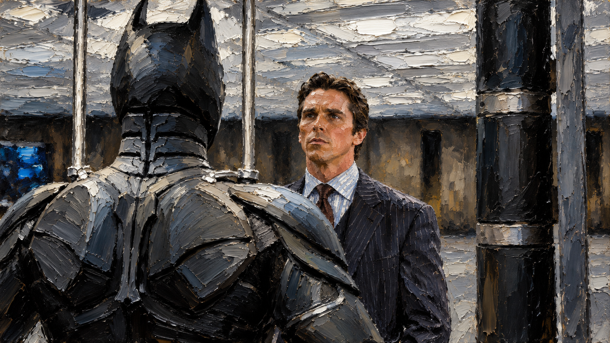

# Impasto Oil Painting Prompts

**English** · [Español](https://github.com/treslou/prompts-oleo-empaste)

A reusable JSON prompt template for AI image generation with **thick impasto oil paint, palette knife strokes, visible paint ridges and cinematic lighting**.

## Quick start

1. Copy [style.json](style.json).
2. Replace the scene field with your subject, setting and action.
3. Choose one palette or describe your own. The alternative palettes are choices, not instructions to combine every palette.
4. Paste the JSON into an image generation tool that accepts natural-language instructions. Attach the reference image if the tool supports image inputs.
5. Add: **"Generate an image following this specification. Use the reference for its painterly texture and depict the scene described."**
6. Select **16:9** in the tool's aspect ratio settings, if available.

Want a ready-to-copy text prompt? Open [examples/ready-to-use-prompt.txt](examples/ready-to-use-prompt.txt).

## Files

| File | Purpose |
| --- | --- |
| [style.json](style.json) | Full English translation of the original Spanish style template, including keys and values |
| [examples/mediterranean-coast.json](examples/mediterranean-coast.json) | Complete example with a scene and one selected palette |
| [examples/ready-to-use-prompt.txt](examples/ready-to-use-prompt.txt) | Plain-text example ready to copy |
| [references/](references/) | Visual reference for texture and finish |

## Example scene

> A terracotta Mediterranean villa beside the sea, with two palm trees in the foreground, a small boat in the bay and golden late-afternoon light.

Change the scene while keeping the style instructions to explore classic sports, coastal landscapes, imposing animals or action scenes.

## The look

- Short, dense, irregular and overlapping brushstrokes.
- Raised paint ridges and a tactile sense of material depth.
- Recognizable subjects, with detail concentrated at the focal point.
- Deep shadows, luminous accents and a limited color palette.
- A single landscape composition without text or interface elements.

If an output looks like a photograph with a texture overlay, reinforce this instruction: **"Build the forms from visible patches and strokes of paint; simplify secondary details."**

## How the template works

The JSON organizes a prompt. It is **not an executable program, an AI model or an API request schema**. No dependencies or installation are required. Use it as instructions in your chosen image generation tool; do not assume these fields can be sent directly to an API.

Interpretation and results depend on the tool. The template does not guarantee an exact match to the reference. The JSON files have been checked for valid syntax; the example prompts have not been tested for image output in this repository.

## Visual reference

The supplied image depicts Bruce Wayne standing before Batman's armor. It illustrates the painterly finish; the style template can be used for other scenes and subjects. This project does not claim official affiliation with the rights holders or grant rights to the characters or the reference image.

## Spanish version

The original project is available at [prompts-oleo-empaste](https://github.com/treslou/prompts-oleo-empaste).
